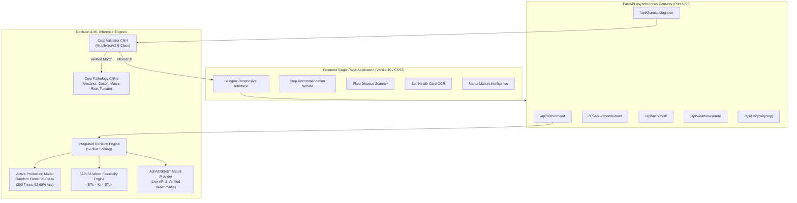

# MannuMitra (ಮಣ್ಣುಮಿತ್ರ) — AI-Based Predictive Farming & Plant Pathology Decision Support System

[](https://www.python.org/)
[](https://fastapi.tiangolo.com)
[](https://scikit-learn.org/)
[](https://keras.io/)
[](LICENSE)

**MannuMitra** (*Friend of the Soil*) is an integrated, explainable Decision Support System (DSS) designed for Indian smallholder and commercial farmers, agricultural extension workers, and regional agronomic planners. 

The system unifies:
1. **Soil-Centric Crop Recommendation** powered by an active 30-Crop Random Forest classifier.
2. **Multi-Pillar Decision Synthesis** blending Agronomy, FAO-56 Irrigation Feasibility, AGMARKNET APMC Mandi Prices, UAS Package of Practices, and Risk Profiles.
3. **Plant Pathology Diagnostics** utilizing transfer-learned MobileNetV2 convolutional neural networks with an integrated Crop Species Validator to eliminate leaf misclassification.
4. **Digital Soil Health Card OCR** extracting soil chemistry directly from official Government PDFs.
5. **Real-Time Meteorological Intelligence** via live Open-Meteo API integrations.
6. **Bilingual Localization** (English and Kannada / ಕನ್ನಡ) across all decision outputs and curative recommendations.

---

## 🏛️ System Architecture



---

## 🧠 Machine Learning & Deep Learning Models

### 1. Active Production Crop Recommendation Model
* **Algorithm:** Random Forest Classifier (`RandomForestClassifier`, 300 estimators, Gini criterion, class_weight='balanced', max_features='sqrt').
* **Artifact Path:** `models/rf_30_class/rf_final.pkl`
* **Classes (30 Karnataka Crops):** `arecanut`, `bajra`, `banana`, `blackgram`, `cardamom`, `cashew`, `chickpea`, `chilli`, `coconut`, `coffee`, `cotton`, `grapes`, `groundnut`, `horsegram`, `jowar`, `maize`, `mango`, `mulberry`, `mungbean`, `onion`, `pepper`, `pigeonpeas`, `pomegranate`, `ragi`, `rice`, `sapota`, `soybean`, `sugarcane`, `sunflower`, `tomato`.
* **Input Features (Strictly 7 unscaled physical parameters):**
  `['N', 'P', 'K', 'temperature', 'humidity', 'ph', 'rainfall']`
* **Dataset:** `karnataka_30_crops_cpcri_rainfall_fixed.csv` (18,780 records, 80/20 stratified split: 15,024 train / 3,756 test).
* **Test Metrics:**
  * **Accuracy:** 92.68%
  * **Balanced Accuracy:** 91.29%
  * **Macro F1-Score:** 91.39%
  * **Weighted F1-Score:** 92.69%
* **Integrity SHA-256:** `856B561797433A11665045E3B9CD9D6035A84FDC130CC2D357B276C8BF5876D5`

### 2. Baseline Research Model
* **Algorithm:** Random Forest Classifier (200 estimators, max_depth=20, min_samples_split=5).
* **Artifact Path:** `models/rf_39_class/crop_model.pkl`
* **Classes (39 Crops):** Baseline model trained on 23,760 samples across 39 classes.
* **Test Accuracy:** 88.30%
* **Status:** Preserved as experimental benchmark comparison.
* **Integrity SHA-256:** `0F0E9A2E2AE1EBE19FC861F64FC8A737534A32DE89143747D04E5E456DEAC779`

### 3. Ensembling Experiments (RF + HGB Hybrid)
* **Architectures Evaluated:** Standalone RF, HistGradientBoosting, Equal Soft Voting, Weighted Soft Voting, and Stacking with Logistic Regression meta-learner.
* **Artifacts:** `models/rf_hgb_hybrid/*.pkl`
* **Finding:** Stacking achieves 92.5-93.0% accuracy, comparable to the 300-tree Random Forest while introducing 3x higher inference latency. Hence, Random Forest was selected for production efficiency.

### 4. Deep Learning Plant Pathology Suite
* **Architecture:** MobileNetV2 with pre-trained ImageNet weights and customized dense classification heads.
* **Backend:** Keras 3 with PyTorch execution runtime.
* **Crops Covered:**
  * **Crop Validator Pre-Screener (5 classes):** Identifies leaf type before disease diagnosis. Rejects cross-crop image uploads (e.g., uploading tomato leaf under cotton).
  * **Arecanut (9 classes):** Koleroga, Yellow Leaf Disease, Healthy, etc.
  * **Cotton (4 classes):** Bacterial Blight, Curl Virus, Fusarium Wilt, Healthy.
  * **Maize (4 classes):** Common Rust, Gray Leaf Spot, Blight, Healthy.
  * **Rice (5 classes):** Bacterial Leaf Blight, Brown Spot, Blast, Sheath Blight, Healthy.
  * **Tomato (10 classes):** Early Blight, Late Blight, Septoria, Healthy, etc.

---

## ⚡ Quick Start & Run Instructions

### Prerequisites
* Windows 10/11 or Linux.
* Python 3.10, 3.11, or 3.12.
* Git & Git LFS.

### Step 1: Clone Repository
```bash
git clone https://github.com/manojtk900/Major_Project_phase2_demo.git
cd Major_Project_phase2_demo
git lfs pull
```

### Step 2: Install Dependencies
```bash
python -m venv venv
# Windows:
venv\Scripts\activate
# Linux/macOS:
source venv/bin/activate

pip install -r requirements.txt
```

### Step 3: Launch the Application
**Option A (One-Click Windows Launcher):**
```bat
run.bat
```

**Option B (Command Line):**
```bash
cd backend
python -m uvicorn app.main:app --host 127.0.0.1 --port 8000 --reload
```

The system initializes in under 5 seconds:
* **Web UI (Frontend):** [http://127.0.0.1:8000/ui/](http://127.0.0.1:8000/ui/)
* **Interactive API Docs:** [http://127.0.0.1:8000/docs](http://127.0.0.1:8000/docs)
* **Health Check Endpoint:** [http://127.0.0.1:8000/api/health](http://127.0.0.1:8000/api/health)

---

## 🧪 Comprehensive Verification & Test Suite

The repository includes a live end-to-end regression and integration test suite:

```bash
python -m pytest backend/tests/test_live_system.py -v
```

### Test Coverage Highlights:
* ✅ **30-Class Active Model Verification:** Confirms 30 classes, 7 feature orders, and model SHA-256.
* ✅ **All 30 Crops Inference:** Tests mean agronomic vector for every single crop from the dataset.
* ✅ **Top 3 Recommendations & 3 Alternatives:** Confirms disjoint, non-overlapping candidate sets.
* ✅ **Input Bounds & Edge Cases:** Validates Pydantic rejection for unrealistic pH (<3.5, >10.0) and temperature (<5°C).
* ✅ **Disease Model Inference & Mismatch Prevention:** Uploading tomato leaf under cotton is safely intercepted and flagged.
* ✅ **Live Weather Connectivity:** Validates Open-Meteo real-time forecasts.
* ✅ **Market Mandi Diagnostics:** Verifies transparent data provenance badges (`LOCAL BENCHMARK` vs `LIVE API`).
* ✅ **Frontend Asset Integrity:** Verifies UI mount, stylesheets, and crop photography.

---

## 📓 Jupyter Notebooks

Located under `notebooks/`:
1. `01_random_forest_39_class.ipynb` — Training, CV, and evaluation of the 39-crop baseline.
2. `02_random_forest_30_class.ipynb` — Final rigorous validation of the production 30-crop model on 18,780 rows.
3. `03_rf_hgb_hybrid.ipynb` — Ensembling comparison between RF, HistGradientBoosting, Voting, and Stacking.
4. `04_mobilenetv2_disease_detection.ipynb` — Model loading, evaluation, and live inference with Grad-CAM overlays.

---

## 🛡️ Data Provenance & Real-World Disclaimers

1. **Agronomic Data:** Tabular soil and climate records are synthetic/simulated distributions calibrated against ICAR-CPCRI and UAS Bengaluru Package of Practices guidelines. Test set accuracy measures mathematical model generalizability on the held-out split, not guaranteed real-world field yield.
2. **Market Prices:** Live market prices connect to AGMARKNET via data.gov.in when an official API key is configured. If unconfigured, the system explicitly labels observations with the `LOCAL BENCHMARK` badge to ensure full transparency.
3. **Disease Diagnostics:** Deep learning diagnoses are advisory tools designed to assist farmers and extension workers. Chemical treatments should always be cross-checked with a local agricultural extension officer or Raitha Samparka Kendra.

---

## 📄 License & Attribution

Developed for academic presentation, viva demonstration, and open agricultural research.
Distributed under the MIT License.
